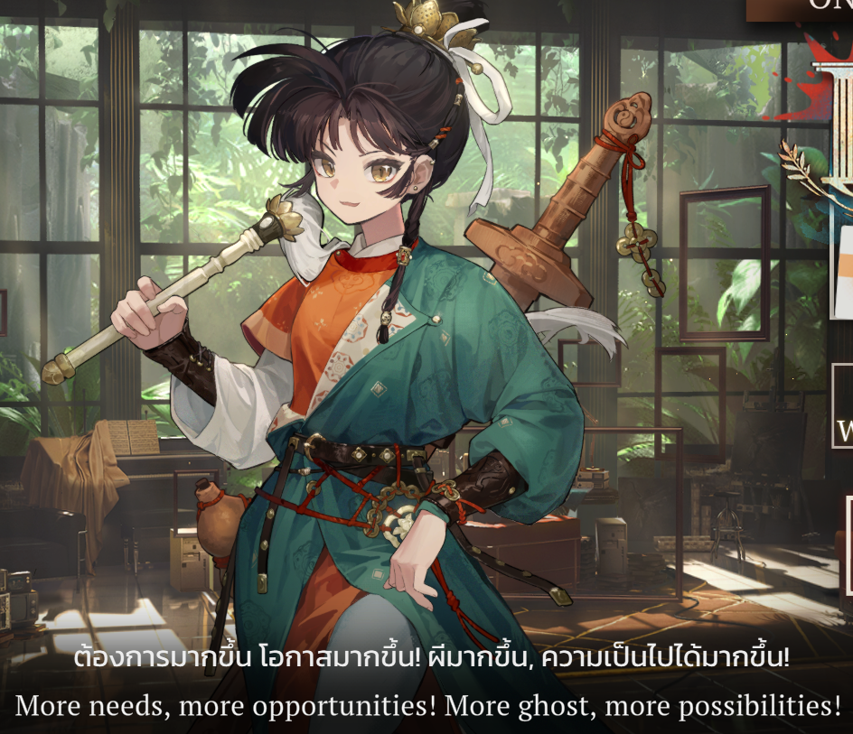
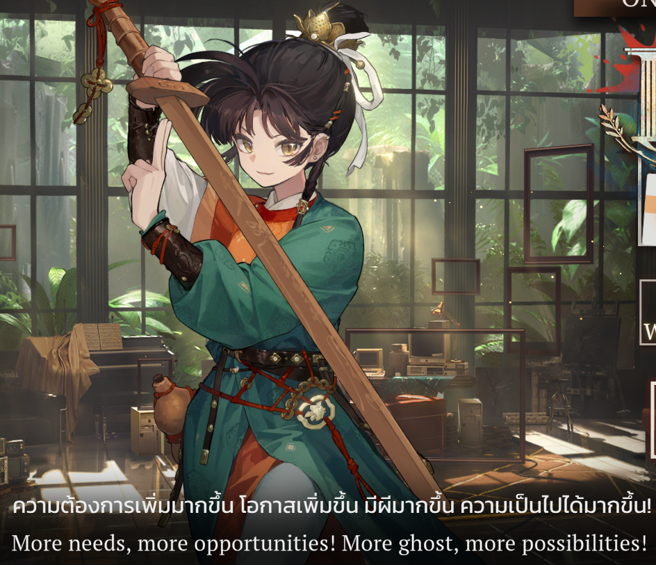
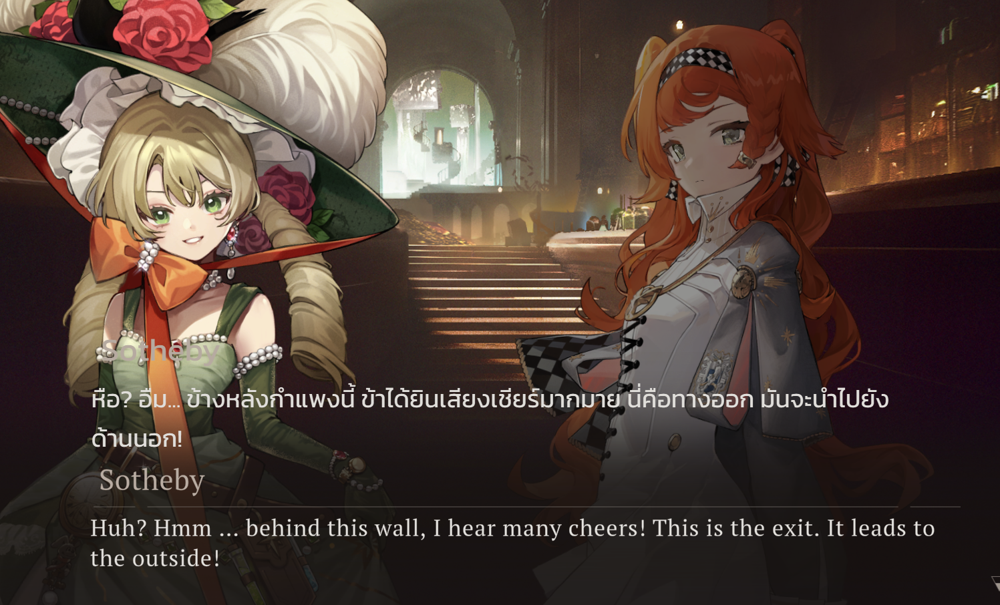
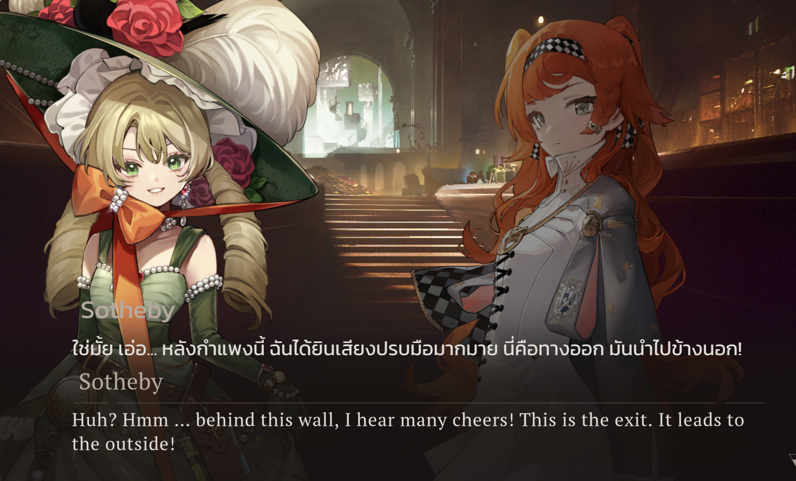

# R1999 Translator

Offline subtitle translator for the Reverse: 1999 PC client. It reads the game's English subtitles from the screen and draws a translation over them. After the translation model has been downloaded, nothing leaves the computer.

## What to expect

- The translation is made in real time while the game runs, so it appears a moment after the subtitle, not together with it.
- It is machine translation and is not always accurate. It helps to follow the overall context of a scene.
- Understanding English and listening to the voice acting are still needed. The translation only eases the load of the difficult words the game uses, more or less.

## Screenshots

The same line of the main menu, translated by each translator:

| Argos (default, faster) | NLLB-200 (larger) |
| :---: | :---: |
|  |  |

The same dialog in the game:

| Argos (default, faster) | NLLB-200 (larger) |
| :---: | :---: |
|  |  |

## Install

1. Download `R1999Translator-Setup-<version>.exe` from [Releases](https://github.com/TamKungZ/Reverse1999SubTranslator/releases) and run it. It installs for the current user and needs no administrator rights.
2. Set the game's text language to English and run the game in windowed or borderless mode.
3. Start R1999 Translator. On the first start it downloads the Argos model (about 64 MB), which translates about ten times faster than the other one. NLLB-200 (about 620 MB) keeps downloading in the background, and you are told when it is ready. Both are kept loaded, so the F9 menu switches between them at once. A message says that the program is running, and it stays in the system tray at the bottom right.

Requires Windows 11 (64-bit). Windows N editions also need the Media Feature Pack from Microsoft.

## Use

| Key | Action |
| --- | --- |
| F7 | Translation on / off |
| F8 | Sentence / word mode |
| F9 | Settings (arrow keys, Enter, Esc) |
| F10 | Save a screenshot with the translation to `Pictures\R1999Translator` |

The translation is drawn over the game's subtitles in the same size, colour and alignment. The F9 menu changes the font, the size, the languages and more. Messages about loading and downloading appear in the corner of the screen, with a sound that the menu can turn off.

The overlay is hidden from screen capture on purpose, so the program does not read its own translation, which means other screenshot and recording tools do not show it. Use F10 to get a picture with the translation.

## Languages

The game text is read in English and translated into:

| Language | Status |
| --- | --- |
| Thai | Tested the most |
| Indonesian | Same model, little testing |
| Vietnamese | Same model, little testing |

The program itself is available in English and Thai.

## Customizing

Everything below lives in `%APPDATA%\R1999Translator`.

- **More target languages:** add entries to `engine\languages.json`. The translation model covers about 200 languages. Format: [languages.json](engine/r1999engine/data/languages.json).
- **Names and game terms:** add or fix entries in `engine\glossary.json`. Format: [glossary.json](engine/r1999engine/data/glossary.json).
- **Program languages:** add `locales\<code>.json`. Format: [en.json](ui/r1999ui/locales/en.json).

Another interface can use the engine through its local HTTP protocol, see [docs/PROTOCOL.md](docs/PROTOCOL.md).

## License

Source code: Mozilla Public License 2.0, see [LICENSE](LICENSE). The translation model is NLLB-200 under CC-BY-NC-4.0, which does not allow commercial use. The Argos models are OPUS-MT models packaged by Argos Open Tech under CC-BY-4.0. Releases bundle the Kanit font under the SIL Open Font License 1.1.
